**TIDI Calibration and Measurement Algorithm Document (CMAD)**

Version 1

Contents

[1 Scope 1](#1scope)

[2 Related Documentation 1](#2related-documentation)

[2.1 Applicable Documents 1](#21applicable-documents-)

[3 Overview and Background Information 1](#3overview-and-background-information)

[3.1 Science Objectives 1](#31science-objectives)

[3.2 TIDI Instrument Description 1](#32tidi-instrument-description)

[3.2.1 Overall TIDI Measurement Concept 1](#321overall-tidi-measurement-concept)

[3.2.2 TIDI Instrument Subsystem Descriptions 4](#322tidi-instrument-subsystem-descriptions)

[3.2.2.1 Filter wheel system 4](#3221filter-wheel-system)

[3.2.2.2 Etalon 5](#3222etalon)

[3.2.2.3 CCD 5](#3223ccd)

[3.2.3 TIDI Heritage 7](#323tidi-heritage)

[3.2.3.1 Instrument Heritage 7](#3231instrument-heritage)

[3.2.3.2 Algorithm and Calibration Heritage 7](#3232algorithm-and-calibration-heritage)

[4 TIDI Calibration Plan 7](#4tidi-calibration-plan)

[4.1 Overall Calibration Scheme 7](#41overall-calibration-scheme)

[4.2 Pre-flight Calibration Efforts 7](#42pre-flight-calibration-efforts)

[4.3 In-flight Tracking of Short-Term Changes 8](#43in-flight-tracking-of-short-term-changes)

[4.4 Long-term Absolute Calibration Tracking (Re-Calibration) 8](#44long-term-absolute-calibration-tracking-re-calibration)

[4.5 Validation 9](#45validation)

[4.5.1 Systematic bias in Measurements from Telescope 1 9](#451systematic-bias-in-measurements-from-telescope-1)

[4.5.2 Cross-compare with ICON/MIGHTI 11](#452cross-compare-with-iconmighti)

[4.5.3 Figure of Merit 14](#453figure-of-merit-)

[4.5.4 Rebaselining Zero Winds 15](#454rebaselining-zero-winds)

[5 TIDI Measurement Algorithm Descriptions 18](#5tidi-measurement-algorithm-descriptions)

[5.1 Theoretical Basis 18](#51theoretical-basis)

[5.2 Conversion of Instrument Signals 18](#52conversion-of-instrument-signals)

[5.2.1 Conversion of Level 0 to Level 1 18](#521conversion-of-level-0-to-level-1)

[5.2.2 Conversion of Level 1 to Level 1 18](#522conversion-of-level-1-to-level-1)

[5.2.3 Conversion of Level 2 to Level 3 19](#523conversion-of-level-2-to-level-3)

[5.3 Signal Estimates and Error Analyses for Subsystems 19](#53signal-estimates-and-error-analyses-for-subsystems)

[5.4 Preflight Calibration Algorithms 19](#54preflight-calibration-algorithms)

[6 TIDI Data Processing 19](#6tidi-data-processing)

[6.1 Data Product Description 19](#61data-product-description)

[6.2 Data Processing Flow 19](#62data-processing-flow)

[6.2.1 Process EPET data and get different thrends 20](#621process-epet-data-and-get-different-thrends-)

[6.2.2 Main LOS, PRF, and VEC calculation 20](#622main-los-prf-and-vec-calculation)

[6.2.3 Run version D011 RETRIEVE, IDL (for LOS), INVERT and VECTOR 20](#623run-version-d011-retrieve-idl-for-los-invert-and-vector)

[6.2.4 Create plots for website and other analysis 20](#624create-plots-for-website-and-other-analysis)

[6.3 Main Modules 21](#63main-modules)

[6.3.1 Retrieve 21](#631retrieve)

[6.3.2 Invert 22](#632invert)

[6.3.3 Vector 23](#633vector)

[6.4 Data Organization 24](#64data-organization)

# 1 Scope

This document describes the overall concept for calibrating the TIMED Doppler Interferometer (TIDI) instrument for the Thermosphere-Ionosphere-Mesosphere Energetics and Dynamics (TIMED) mission including preflight and inflight calibrations, and discusses the algorithms for converting instrument signals to global winds.

# 2 Related Documentation

## 2.1 Applicable Documents

M. Cooper (2003), "RETRIEVE Design and Maintenance".

A. Marshall (2003), "Invert Design and Maintenance".

E. Wolfe (2003), "Vector Design and Maintenance".

R. Niciejewski et al. (2006), "TIMED Doppler Interferometer on the Thermosphere Ionosphere Mesosphere Energetics and Dynamics satellite: Data product overview"

T. L. Killeen et al. (2006), "TIMED Doppler Interferometer: Overview and recent results"

# 3 Overview and Background Information

## 3.1 Science Objectives

The TIMED Doppler Interferometer (TIDI) is investigating the dynamics and energetics of the Earth's mesosphere and lower-thermosphere. TIDI complements other instrumentation on the TIMED satellite that measure temperature and composition and solar UV radiation. TIDI provides basic information about global winds. TIDI also contributes to the study of energetics.

The TIDI interferometer (or Profiler) measures horizontal vector winds from the Earth's limb, with a vertical resolution of 2.5 km and an accuracy that approaches ~3 m/sec under optimum viewing conditions. The TIDI design allows for 100% duty cycle instrument operation during daytime, nighttime, and in auroral conditions. TIDI samples airglow emissions in the mesosphere and thermosphere to determine the line of sight Doppler wind.

## 3.2 TIDI Instrument Description

### 3.2.1 Overall TIDI Measurement Concept

TIDI comprises three major subsystems to measure the Doppler shift of airglow emissions: four identical telescopes, a Fabry-Perot interferometer with a CCD detector, and an electronics box. Light from the selected regions of the atmosphere is collected by the telescopes and fiber-optically coupled to the detection optics. The four fields of view are scrambled along with a calibration field input and converted to an array of five concentric circular wedges. This input then passes through a selected filter, then through a Fabry-Perot etalon, and is finally imaged onto a CCD via a circle to line imaging optic (CLIO) device.

The features observed by TIDI are shown in Table 1. There is one day mode and one night mode which take advantage of the most intense airglow features that are available to the detector. The filter wheel sequence selection is determined by a day/night monitor. The instrument subsystems are described in more detail in the following sections. The overall layout is illustrated in Figure 1.

**Table 1**. Airglow features observed by the TIDI instrument. The start and stop altitude for each filter selection are indicated as well as the altitude step between successive integrations.

| **TIDI ID#** |       | **Feature**                                                                                             | **Start, stop, delta (km)**                                                               | **Integration (s)**                                     |
| ------------ | ----- | ------------------------------------------------------------------------------------------------------- | ----------------------------------------------------------------------------------------- | ------------------------------------------------------- |
| 14611        | Day   | O2 (0,0) P9  O2 (0,0) P15  O (1S)  O (1D) | 80, 115, 2.5  65, 85, 2.5  90, 100, 5  110, 160, 10  160, 300, 20 | 1.0  1.0  1.0  4 x 1.0  4 x 1.0 |
| 14831        | Night | O2 (0,0) P9  O (1D)                                                         | 80, 105, 2.5  160, 300, 20                                                          | 3.0  4.0                                          |

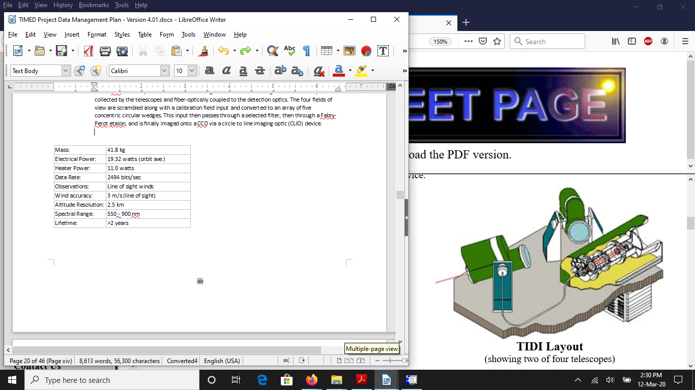

**Figure 1**. Diagram illustrating the TIDI instrument layout. The experiment is located on the top side of TIMED, which faces away from the Earth. To view the airglow limb, the telescopes are pointed downwards and perform step scans in the vertical, scanning upwards through the atmosphere.

In operation, the TIMED satellite is oriented such that the TIDI telescopes reside on the "top" deck. Figure 1 illustrates the layout of the components, indicating that the telescopes must be pointed downwards at an angle to view the terrestrial limb. The output of each of the four telescopes is optically connected to the main TIDI enclosure via optical fibre cabling. Only two of the four telescopes are shown. Figure 2 provides a clearer view of the orientation and layout of the telescopes and the main body of TIDI. The structure houses the filter wheels, the etalon chamber, and the CCD detector system. Heat from the CCD is piped to space to keep the detector cold.

Not shown is the TIDI calibration system. This consists of 2 spectral lamps and 2 white-light lamps. These lamps share a fifth optical fibre input and are used to characterize both the throughput of the system (white light) and the finesse (spectral lamps) of the etalon and as a monitor of the zero-wind shift of the fringe profiles. These are deployed when the day-to-night signal is received, that is at satellite dusk. In total, there are 14 different calibration intervals lasting at most 5 minutes per successive dusk periods. These check all aspects of TIDI system and sub-system operation and have been performed each day since February 2002.

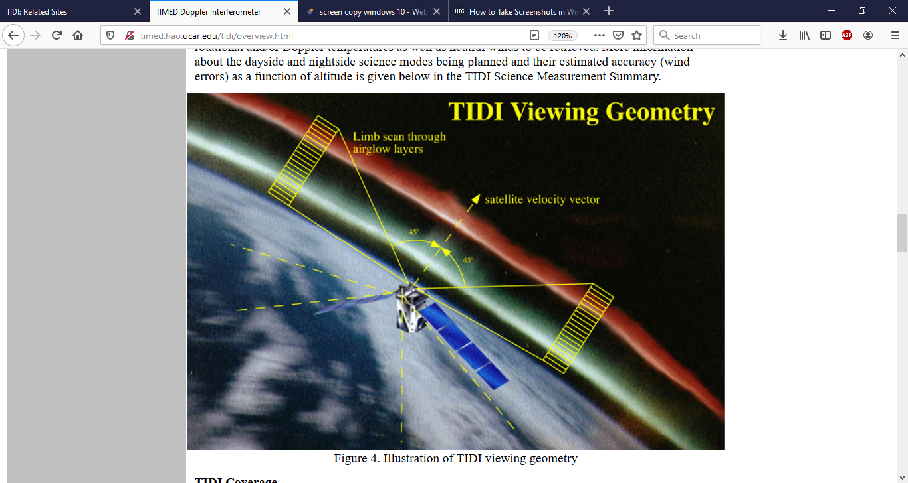

**Figure 2**. The TIMED satellite orbits the Earth at a 74.1 degree inclination angle to the equator at an altitude of about 600km. The TIDI instrument is located on top of the satellite and observes the terrestrial limb with a system of 4 downward limb-scanning telescopes. The telescopes view the limb at 4 orthogonal positions corresponding to azimuth angles of 45, 135, 225, and 315 degrees to the orbital path. The telescopes sample the limb airglow at altitudes corresponding to the stratosphere, mesosphere, and thermosphere. The latitude coverage of the telescopes includes both polar regions. Shutters are employed in the optical path to protect against viewing near the solar direction.

The TIMED orbit was chosen to be circular with a high inclination angle of 74 degrees. The orbital path, in relation to the terminator, is shown for two orientations in Figure 3 during a period of high beta angle. Here, the orbit roughly coincides with the terminator indicating that the Local Solar Time of the satellite is approximately the same for the descending half (and 12 hours later for the ascending half). This is important for TIDI neutral wind observations, providing a nearly constant LST in the northern and southern hemispheres at low and middle latitudes. TIDI samples the atmosphere with two telescopes on the hot sunward side and two on the cold nightward side to provide two independent altitude scans of horizontal wind vectors on either side of the spacecraft. These scans are separated by ~4000 km, or ~35 deg. longitude at the equator, a little over 2 hours of Local Time.

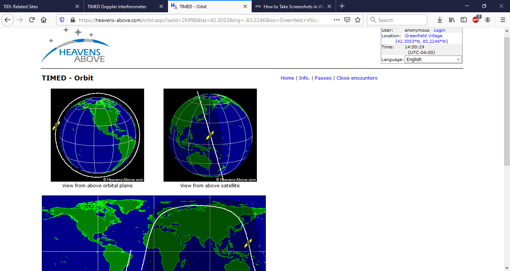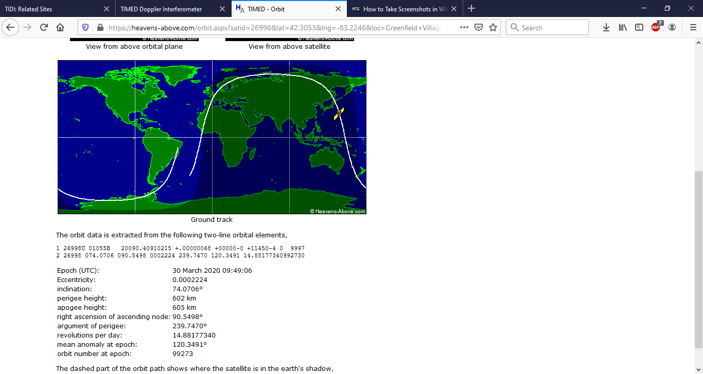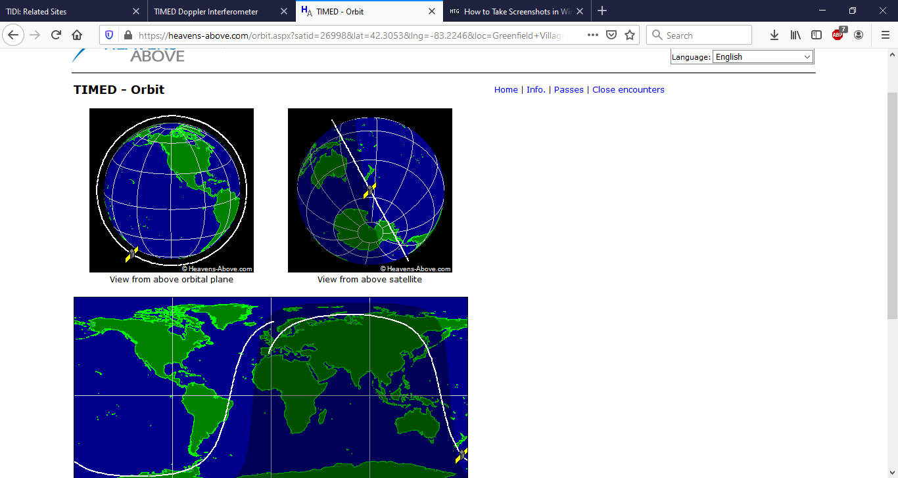

**Figure 3**. Orbital information obtained from heavens-above.com. Left side displays geometry of equator and polar crossings. Right side displays the relationship of the TIMED orbit to Local Solar Time, here, primarily either dusk or dawn.

### 3.2.2 TIDI Instrument Subsystem Descriptions

#### 3.2.2.1 Filter wheel system

The TIDI enclosure houses the Fabry-Perot etalon and detection components. Figure 4 describes the design. The shaped fringe pattern constructed from fibre bundles from each of the four telescopes plus the calibration system first passes through the filter wheel system. This is designed to permit only one airglow feature to pass through for analysis. The telescope input associated is expanded and selected by the filter wheel selection. The as-known filter wheel configuration may be found at <http://tidi.engin.umich.edu/save_lists/documents/pdf_files/4171-FW_Configs.pdf>.

#### 3.2.2.2 Etalon

The TIDI etalon serves to resolve the selected airglow feature into a high-definition spectrum.

#### 3.2.2.3 CCD

The TIDI CCD images the fringe pattern. The image is only recorded during specific lamp calibration sequences. During routine science operation, the image is recorded as a spectral line shape. Both are recorded as Level 0 data.

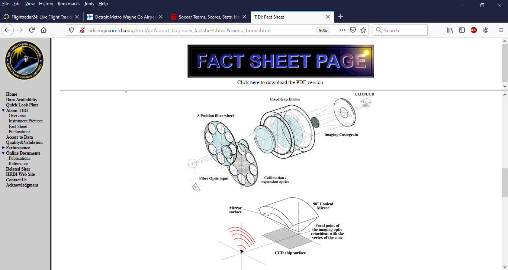

**Figure 4**. Following the light path at top left, a shaped fibre optic bundle consisting of light from the 4 telescopes and the calibration system transmits the observed signal through a filter wheel assembly that selects a specific atmospheric feature. Once the airglow emission is selected, the emission is converted into a circular fringe by the Fabry-Perot etalon. This is then focused onto the CCD detector by a folding conical mirror, a Circle-to-Line Optic or CLIO. The back-end mirror section is designed to image one quarter of the 5-channel circular fringe pattern onto the CCD as lines rather than a circle where the lines are aligned to match the CCD (row, column) pixel pattern.

### 3.2.3 TIDI Heritage

#### 3.2.3.1 Instrument Heritage

The University of Michigan has designed and flown two Fabry Perot interferometers into space prior to TIDI. The first was launched on the Dynamics Explorer 2 mission on August 3, 1981, followed by the HRDI instrument on the UARS mission on 12 September, 1991. The DE-2 FPI flew until February 19, 1983, while the UARS-HRDI experiment fell from orbit on 24 September, 2011, though HRDI stopped operations on 30 March, 2005.

#### 3.2.3.2 Algorithm and Calibration Heritage

As the TIDI experiment was a follow-on from DE-2 FPI and the UARS HRDI, much of the algorithm and calibration heritage is based on the previous experiments. The primary difference between TIDI and the previous missions was the detector package, a CCD on TIDI versus multi-channel devices on the earlier missions.

# 4 TIDI Calibration Plan

## 4.1 Overall Calibration Scheme

The overall calibration of the TIDI experiment may be broken down into individual sub-systems:

Telescope pointing, Interference filter characterization, Etalon reflectivity and gap, CCD sensitivity, dark signal and its temperature dependence.

Much of the initial pre-launch studies have been discussed by Killeen et al., Proceedings of SPIE, vol. 3756, p. 289-301, doi:10.1117/12.366383, 1999.

The performance of the TIDI instrument during the first 1.5 years in orbit has been discussed by Skinner et al., Proceedings of SPIE: Optical Spectroscopic Techniques and Instrumentation for Atmospheric and Space Research V, vol. 5157, p. 47-57, doi:10.1117/12.503727, 2003. In summary, 1) the thermal control system is working as planned; 2) the CCD is working as expected with no changes in gain, bias, or read noise from pre-launch levels; 3) a light leak, location uncertain, causes the background to be elevated increasing the uncertainty of the line-of-sight wind measurement; 4) outgassing, likely of water from the spacecraft or instrument, has deposited as ice on one or more locations along the optical path reducing the sensitivity of the experiment.

The light leak problem remains in 2020, though at roughly 50% of the value in 2002. Much of the reduction is due to two special rolls conducted January 28-29, 2003, and April 1-7, 2003. Sensitivity to the white light calibration source improved to current levels in 2005. Neon calibration lamp continuum background levels are roughly 50% of earlier levels. Daily photon transfer measurements show that the CCD gain levels have been consistent from launch levels to current levels for the three operational gains of 10, 40, and 160 e-/ADU. In addition, the CCD bias levels also remain the same since the turn-on in 2002. RMS CCD read noise levels for the operational 10 and 40 e-/ADU remain at post-launch levels.

Scattering levels due to ice deposition have leveled off and perhaps zeroed. The long-term trend of scattering from the fibre bundle carrying the calibration lamp signal into the adjacent telescope signal, a calibration performed at dusk, suggests minimal if any scattering is present at the CCD. Daily dark count trend measurements suggest that the dark count has leveled off to the resolution element of a CCD pixel, that is, 1 ADU.

## 4.2 Pre-flight Calibration Efforts

Pre-flight calibration efforts are described in Killeen et al., Proceedings of SPIE, vol. 3756, p. 289-301, doi: 10.1117/12.366383, 1999. In-lab using rare gas lamps for spectral line calibration of individual filters and white light calibration with a low intensity radioactive source. In both cases the source illuminates a white screen. These include:

Telescope transmittance, telescope (horizontal/vertical) field-of-view

Fibre optic transmittance as a function of wavelength, individual fibre packing for the calibration deck and the 4 telescope fields, image quality of the fibre optic bundle

Quantum efficiency of the CCD as a function of wavelength, system gain and bias level, readout time for each system gain

Transmission curves for both the narrow-band filters and the wideband blockers

Etalon reflectivity as a function of wavelength

and system characteristics such as

Spectral resolution, estimated sensitivity

## 4.3 In-flight Tracking of Short-Term Changes

Short-term changes in TIDI performance are checked with daily observations of an on-board white light source for each filter, as discussed in Skinner et al., Proceedings of SPIE: Optical Spectroscopic Techniques and Instrumentation for Atmospheric and Space Research V , vol. 5157, p. 47-57, doi:10.1117/12.503727, 2003. For those filters which may transmit a neon emission line, daily observations of an on-board neon lamp source are performed.

In addition, weekly dayside observations of Rayleigh scattering for tangent altitudes 40 and 45 km, employing narrowband filters O2P9, O2P15, OI(557.7), and OI(630.0) are performed. One dayside orbit is devoted to each filter.

The thermal performance of TIDI is important for measuring the line-of-sight wind. Daily trends of the temperature of important components (CCD sensor window, etalon post, and the CCD) have been performed since launch.

Any changes in the performance of the CCD affect the determination of the line-of-sight wind. Daily checks of the CCD bias level, gain level, and noise level are performed. White light trend plots of brightness for each filter are performed on a daily basis. Recordings of neon lamp images detail the effect of scattering on signal levels.

## 4.4 Long-term Absolute Calibration Tracking (Re-Calibration)

The MLT (Mesosphere-Lower Thermosphere) has been sampled continously by UM-SPRL space borne experiments since 1991. Long-term sampling of the low-latitude meridional wind may be used to extract the strength of the migrating diurnal tide, the Hough (1,1) mode. This tide is dominant in March and has been sampled, independently, by [WINDII (1992-1997)](http://tidi.engin.umich.edu/html/go?science_sum/WINDII_Hough/), by [HRDI (1992-2005)](http://tidi.engin.umich.edu/html/go?science_sum/HRDI_Hough/), and by [TIDI (2003-present)](http://tidi.engin.umich.edu/html/go?science_sum/Hough/). _\[WINDII operated by York University, Toronto\]_ The data show consistency during correlative operations. Long-term variability in the migrating diurnal tide is related to the phase of the QBO (Quasi-Biennial Oscillation) in the tropical stratosphere.

**Figure 5**. Long-term variations of Hough (1,1) amplitude meridional wind from TIDI (year 2002-2020), HRDI (1992-2005), and WINDII (1992-1997).

## 4.5 Validation

### 4.5.1 Systematic bias in Measurements from Telescope 1

Due to the yaw maneuver every ~60 days, the coldside and the warmside telescopes view each of the four directions fixed to the satellite alternatively (Figure 6). Systematic bias in the measurements by Telescope 1 during forward flight is reported by Wu and Ridley, (2023). As an example, Figures 7 and 8 show the line of sight (LOS) winds in two directions of the satellite at one geophysical location as a function of the day of year in 2020. Obvious systematic bias is found in the measurements by Telescope 1 during forward flight, which is larger than the average wind speeds.

**Figure 6.** The geometry and measurements of TIMED Doppler Interferometer based on an example on 1 Jan 2020 (Wu and Ridley, 2023).

**Figure 7.** Line of sight (LOS) winds in directions C (a) and D (b) that are denoted in Figure 6, the LST (c), SZA (d), and SSA (e) as a function of the day of year at the latitude of 26°–34° and the altitude of 92–98 km in the ascending phase. The blue, cyan, red, and magenta dots represent Tel1 (coldside), Tel2 (coldside), Tel3 (warmside), and Tel4 (warmside), respectively. The black crosses and triangles represent the daily means of LOS winds from the warmside and coldside telescopes, respectively. Daily means of the HWM LOS winds are over-plotted as orange lines. The satellite is in backward flight on days 1–56, 119–175, 239–301, and 357–366, while it is in forward flight on days 56–119, 175–239, and 301–357.

**Figure 8.** Similar to Figure 7, but for the descending phase.

The systematic bias in the measurements of Telescope 1 during forward flight began to occur in 2015.

### 4.5.2 Cross-compare with ICON/MIGHTI

The Ionospheric Connection Explorer (ICON) was launched in October 2019. The Michelson Interferometer for Global High-resolution Thermospheric Imaging (MIGHTI) onboard ICON provides a new wind dataset at low- and mid-latitudes from 90 to 300 km (Englert et al., 2017; Harding et al., 2017, 2021; Immel et al., 2018; Makela et al., 2021).

The Line of Sight (LOS) winds from individual TIDI telescopes are compared to the measurements from MIGHTI from 90 to 100 km altitude during 2020. This is done by projecting the MIGHTI vector winds onto the LOS direction of each TIDI telescope for coincidences of the two data sets. The four telescopes perform differently, and the performance depends on the satellite configuration and local solar zenith angle. Measurements from the coldside telescopes, Telescope 1 (Tel1) and Telescope 2 (Tel2), are better correlated with the MIGHTI winds in general with Tel2 having higher correlation coefficients across all conditions. The performance of Tel1 is comparable to that of Tel2 during backward flight while showing systematic errors during forward flight, which is descried in Section 4.5.1. The warmside LOS winds from Telescope 3 (Tel3) and Telescope 4 (Tel4) vary widely in magnitude, especially on the nightside. Compared with MIGHTI winds, the Tel4 measurements have the weakest correlation, while the Tel3 performance is comparable to that of the coldside telescopes during the ascending phase but deteriorates during the descending phase. 

**Figure 9.** Point-to-point comparisons between TIDI Telescope 1 and MIGHTI LOS winds from 90 to 100 km in different solar zenith angles bins in different configurations of the satellite.

**Figure 10.** Similar to Figure 9, but for Telescope 2.

**Figure 11.** Similar to Figure 9, but for Telescope 3.

**Figure 11.** Similar to Figure 9, but for Telescope 4.

### 4.5.3 Figure of Merit

The TIDI-ICON line-of-sight wind comparisons (Section 4.5.2) indicate that the performance of the four telescopes (Tel1, Tel2, Tel3, and Tel4) is different depending on the satellite configurations (Ascending/backward, Descending/backward, Ascending/forward, and Descending/forward) and solar zenith angle (SZA). To quantify the quality of the measurements from individual telescopes, figures of merit were generated based on the linear least-squares regression fittings and correlations between coincident measurements from TIDI and ICON. Ideally, in each SZA bin of different satellite configurations, the slope (k), intercept (b), and correlation coefficient (r) should be equal to 1, 0, and 1, respectively. The closer the parameters are to the ideal values, the better the two datasets are consistent. Thus a score ranging from 0 to 10 is calculated for each parameter: 0 for the worst case, 10 for the best case, with a linearly scaled score in between. The total score in each SZA bin is then the mean of the three scores. The dayside and nightside scores are weighted averages of the scores from 0-90° SZA and 90-180° SZA, respectively.

**Figure 12.** Performance figures of merit for each telescope on the dayside (0°–90° SZA) and the nightside (90°–180° SZA) during the ascending (left) and descending phases (right). The blue and red background colors represent the backward and forward flights, respectively. In each configuration, the score is represented by the size of the circle and labeled; the color of the circle represents the number of events.

Overall, the figure of merit is provided as a quality flag for TIDI measurements for each satellite configuration and telescope based on the comparisons with MIGHTI observations. (a) For a score ≥5, the TIDI and MIGHTI measurements are consistent. Under this condition in each SZA bin, the correlation coefficient is usually larger than 0.5; the slope tends to be larger than 0.5; and the RMSD between the two datasets is ∼50–60 m/s. (b) For a score <=3, the measurements are very scattered or with systematic errors, showing the weakest correlation. (c) For a score = 4, one should be cautious about the data. Specifically, TIDI data is consistent with MIGHTI wind measurements in the MLT region when certain conditions are met: (a) For Telescope 1, measurements are consistent with MIGHTI during backward flight (excluding Ascending node / Backward / Night), and some of those with the ratio of the brightness to standard deviation brightness less than 30 during forward flight; (b) For Telescope 2, the measurements are generally consistent with MIGHTI across all conditions; (c) For Telescope 3, consistent measurements are from the Ascending node / Daytime configuration; (d) Telescope 4 data are very scattered showing the weakest correlation with MIGHTI measurements in general; and (e) to match MIGHTI level 2.2 data better, the measurements meeting the requirements above (good data) can be further restricted with the magnitudes less than 100 m/s to exclude outliers.

### 4.5.4 Rebaselining Zero Winds

The bias in the codeside telescopes described in Section 4.5.1 has occurred since 2015, which results from the zero correction term that is designed to adjust the zero winds. As shown in the example for 2015 (Figures 13 and 14), the zero correction term fails to correct the Line of Sight (LOS) winds during the forward flight for both the ascending and the descending phases, while it corrects the LOS winds well during other times and for Telescope 3. After adding back the zero correction term, the LOS winds have two distributions (bottom in Figures 13 and 14) which are from two different emissions. Further analysis shows that the biases occur in the emission of O2 (0-0) P9, but winds derived from the other emission, O2 (0-0) P15, are fine.

**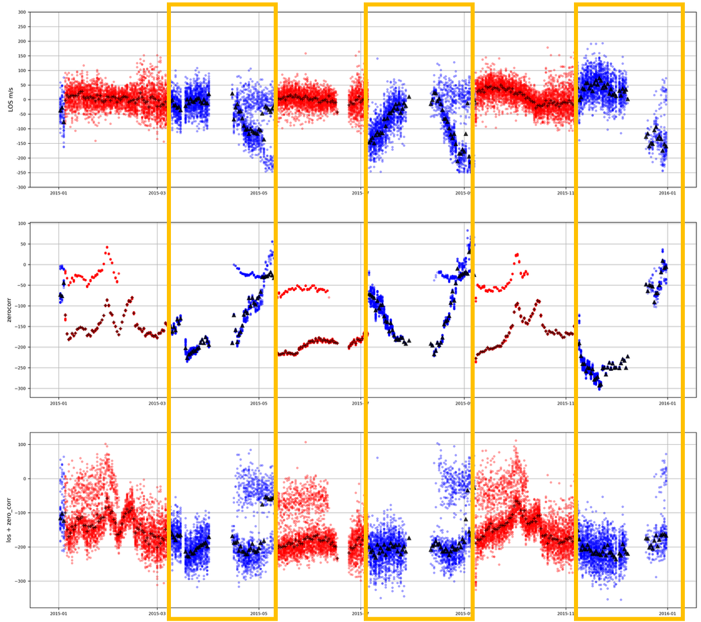**

**Figure 13.** Line of Sight winds (top), zero correction (middle), and LOS winds before zero correction (bottom) for Tel3 (red) and Tel1(blue) during the acceding phase in the Year of 2015.

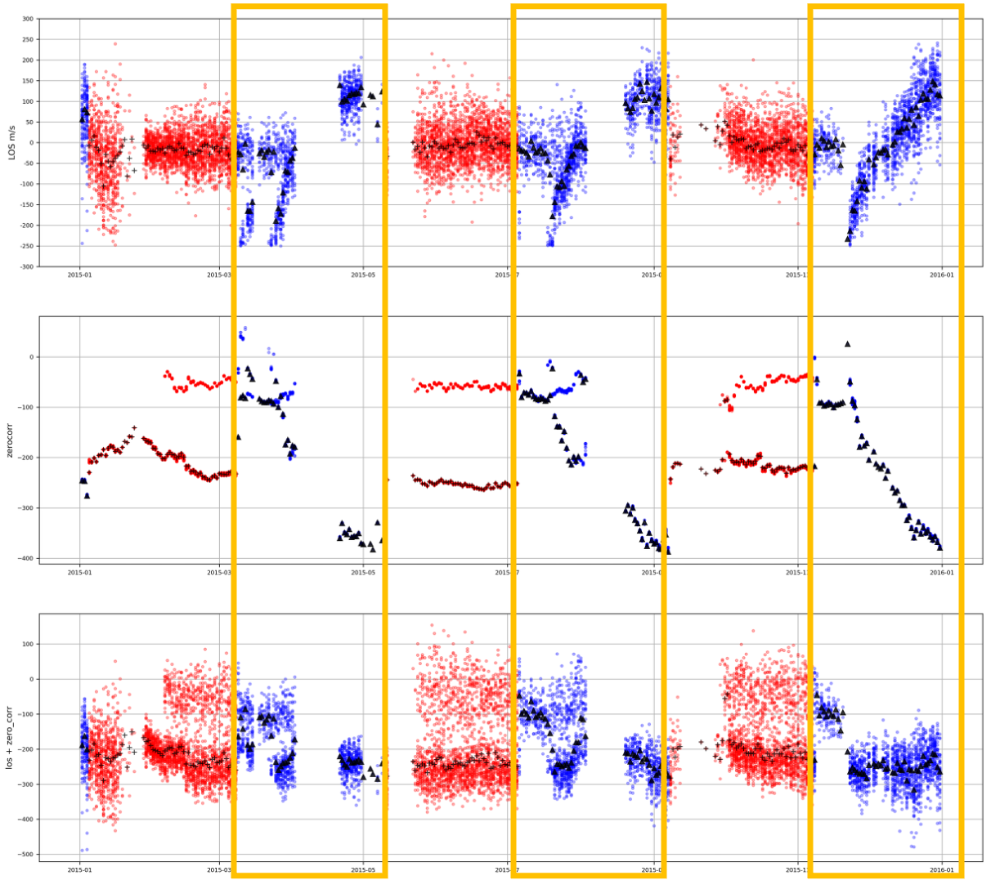

**Figure 14.** Similar to Figure 13 but for the descending phase.

This discovery allows to compare the biases between the different emissions and then make them consistent with each other. When the bad emission wind is debiased in the same way as the good emission (ignoring the bias that was added by the old software to "debias" the data), the distributions of the winds started to align. Figure 15 (left) shows an example of the distributions of the LOS winds before and after the corrections.

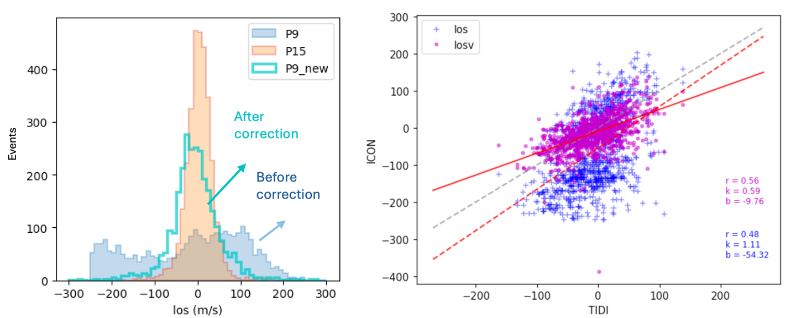

**Figure 15.** An example that shows the distribution of the Line of Sight winds before and after the correction (left). Comparisons between TIDI LOS winds and ICON/MIGHTI measurements before and after the correction (right). The blue color represents the data before correction, while the magenta color represents the new datasets.

To validate the new dataset of LOS winds, the measurements at ~97.5 km are compared to the measurements from ICON/MIGHTI during a forward flight in 2020. This is done by projecting the ICON/MIGHTI vector winds onto the LOS direction of each TIDI telescope for coincidences of the two datasets, as done in section 4.5.2. As shown in Figure 15 (right), the rebaselined TIDI measurements becomes consistent with those from ICON/MIGHTI. Therefore, the large bias reported in section 4.5.1 can be removed with this approach.

# 5 TIDI Measurement Algorithm Descriptions

## 5.1 Theoretical Basis

TIDI telemetry data are available to the TIDI Payload Operations Center at the University of Michigan on the second day following data acquisition, and these are routinely converted into a Level 0 product (raw spectrum data).

To retrieve winds from the spectrum data, a nonlinear fit of a forward model to the measurements are performed. The forward model parameters include the atmospheric profiles of wind, temperature, volume emission rate, and Rayleigh scattered background which are simultaneously recovered as part of the standard data processing, and also several parameters that describe the state of the instrument. The retrieved wind includes several satellite-induced effects which need to be subtracted to obtain the true line of sight geophysical wind. The background caused by a light leak of the profiler and the "cross-talk" between different telescope fields are also considered. This is Level 1 data.

The forward model can be reformulated to describe the measurements depending on atmospheric profiles of wind, temperature, volume emission rate, and a scattering background. The altitude profiles of wind can then be inversed by linearizing the forward model and applying a constrained nonlinear least-squares fitting method. This is Level 2 data.

TIDI samples two sides of the satellite. For each side, the two telescopes will sample the same location about 9 min apart as the satellite moves along its orbit. To calculate the vector winds, (1) the samplings from each telescope are linearly interpolated at evenly spaced track angle grid points; (2) then the meridional and zonal winds are calculated at these evenly spaced track angle grid points. This is Level 3 data. Details can be obtained from Killeen et al. (2006)

## 5.2 Conversion of Instrument Signals

### 5.2.1 Conversion of Level 0 to Level 1

TIDI Level 1 data is also referred to as RETRIEVE. The file format may be found in document <https://tidi.engin.umich.edu/wp-content/uploads/sites/645/2023/10/4191-LOSFileFormat.pdf>. The RETRIEVE fitting algorithm specification may be found in document <https://tidi.engin.umich.edu/wp-content/uploads/sites/645/2023/10/4243-Retrievefitting.pdf>. The long-term drift model specification may be found at <https://tidi.engin.umich.edu/wp-content/uploads/sites/645/2023/10/4134-LongTermDrift.pdf>.

### 5.2.2 Conversion of Level 1 to Level 1

TIDI Level 2 data is also referred to as PROFILE. The file format may be found in document <https://tidi.engin.umich.edu/wp-content/uploads/sites/645/2023/10/3532-ProfileFileFormat.pdf>. The INVERT fitting algorithm specification may be found in document <http://tidi.engin.umich.edu/save_lists/documents/pdf_files/3658_TIDIAlgo.pdf>.

The Invert Users Guide may be found at <https://tidi.engin.umich.edu/wp-content/uploads/sites/645/2023/10/4280InvertUsersGuide.pdf>.

### 5.2.3 Conversion of Level 2 to Level 3

TIDI Level 3 data is also referred to as VECTOR. The file format may be found in document <https://tidi.engin.umich.edu/wp-content/uploads/sites/645/2023/10/3933-VectorFileFormat.pdf>. The VECTOR algorithm specification may be found in document <https://tidi.engin.umich.edu/wp-content/uploads/sites/645/2023/10/4263-Revised_Vec_Algo.pdf>. The Vector Users Guide may be found at <https://tidi.engin.umich.edu/wp-content/uploads/sites/645/2023/10/4279VectorUsersGuide.pdf>.

## 5.3 Signal Estimates and Error Analyses for Subsystems

## 5.4 Preflight Calibration Algorithms

# 6 TIDI Data Processing

## 6.1 Data Product Description

Tidi05 processes the Level 0 data product and generates Levels 1-3 products daily. The data products being generated have two versions: Version 10 (D010) (available after three days) and Version 11 (D011) (available on the second day). Differences in versions can be found on the TIDI website (<http://tidi.engin.umich.edu>). Version 11 is made available to NASA for public release.

TIDI data products are organized into the four different levels as follows:

- Level 0 (.TL0, Raw Spectra Files): Telemetry data that has been reconstructed. The product is unprocessed instrument raw spectra data at full resolution.
- Level 1 (.LOS, Line-of-Sight Files): Contains the raw spectra given in counts and corrected spectra given in Rayleighs per inverse centimeter (after the removal of instrument artifacts). Time and position information are included, as well as the line of sight brightness, the line of sight background, and the line of sight wind speed. The product is time referenced.
- Level 2 (.PRF, Wind Profiles): Contains the inverted winds at each level in a height profile. In addition to time and position information, the inverted background and volume emission rate at each level in the profile are also included.
- Level 3 (.VEC, Wind Vectors): Contains the zonal and meridional components of the vector winds mapped onto an evenly spaced track angle grid, as a function of altitude. Also included are volume emission rate and background level information.

## 6.2 Data Processing Flow

TIDI data processing basically consists of four parts, as shown in Figure 15. The section of the EPET data analysis is responsible for all kinds of trend data analysis, followed which Versions 10 and 11 data products are generated. At last, the plots for the website display are created and some analysis is conducted. The following description provides the main scripts and modules that are called.

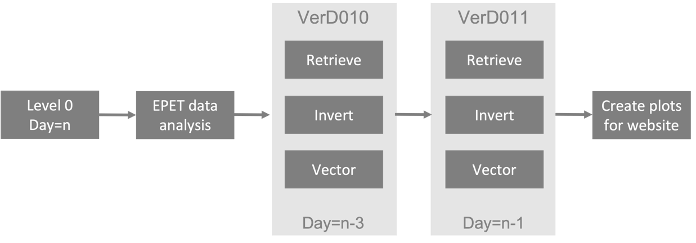

**Figure 15**. Chart of TIDI data processing flow.

### 6.2.1 Process EPET data and get different thrends

1. Process EPETs; Daily calibrations

- analyze.F (Analyzes epet data collected from the TIDI instrument and prepares files that will be later plotted by IDL routines.)

2. Process the calibration image data

- epetsImage.c (Extract image data for image epet. This program produces two files, a diagnostic file and a trend file.)

3. Create the EPET plots for the whole mission and the past three months

- diagnostic_plots (Reads in a command line argument to get the date of the diagonstic files to plot and possibly print out.)
- make_trends.pl (Combine all of the trend data into trend files.)

### 6.2.2 Main LOS, PRF, and VEC calculation

1. Run version D005 of getbackground for future D011 run

- run_verD011

2. Run version D010 RETRIEVE, IDL (for LOS), INVERT and VECTOR

- run_verD010

### 6.2.3 Run version D011 RETRIEVE, IDL (for LOS), INVERT and VECTOR

- rerun_verD011

### 6.2.4 Create plots for website and other analysis

1. Process the norcal data from LOS files

- process_norcal.pro (Extract norcal data from los file and create difference spectra for the day.)

2. Fit the crosstalk data with find_cross_norm

- runFindCrossNormDATA.pl

3. Plot the crosstalk data for viewing on web pages

- runFindCrossNormPS.pl

4. Process VEC file for Daily TIDI Quick Look plots (calendar)

- runDailyPlots.pl

5. Plots the white light norcal shift

- runNorcalShiftPlots.pl

6. List any missing days of LOS, PRF, and VEC

- missingD010.pl

7. Add to engineering trends and plot. Runs IDL (etrending, report_etrends)

- runEnginTrends.pl
- data_availability_D010.pl
- data_availability_D011.pl

8. Create and plot results of pstatus study (daily_pstat)

- find_pstat
- pstat_plot

9. Create daily XTK file. Essential for version D011 and greater

- run_all

10. Make white shift plots

- runNorcalShiftPlots.pl

11. Plot the coefficents for the web page

- run_all

12. Run cleanup script to move current files to proper place and delete old files

- DailyCleanUp.pl

13. Run event logger as a background job

- runEvent.pl

## 6.3 Main Modules

Figure 16 shows the three main modules of data processing: Retrieve, Invert, and Vector which are responsible for producing Levels 1-3 products, respectively.

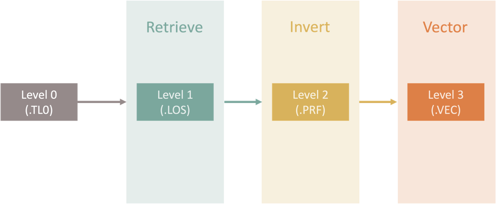

**Figure 16**. Main modules of data processing.

### 6.3.1 Retrieve

The Retrieve program reads TIDI Level 0 files, processing the science data contained in them into a series of LOS measurements of the wind speed, temperature, and other quantities. These results, along with the collection conditions for the measurements, are stored in a TIDI Level 1 file, the LOS file (one file for each run of the program).

The instrumental and satellite-induced artifacts are removed. The spectra are (1) checked for cosmic ray strikes, (2) background corrected, (3) normalized with a white light calibration, and (4) converted to absolute brightness units. Then the LOS velocity is determined separately for each telescope field (It is determined by a set of linear functions derived from the instrument function modeled with a Fourier series representation based on prelaunch measurements of the etalon gap and reflectivity). The "true" LOS wind then is calculated by shifting the "zero" wind position due to (1) instrument temperature fluctuations, (2) long-term instrument drift, (3) the component of the spacecraft velocity along the LOS, and (4) the component of Earth rotation along the LOS.

The calling tree is as follows:

- CONST
- READ_L0_FILE
- mTime2doyTime
- mTime2calTime
- OPEN_CPF
- OPEN_PVAT_FILE
- BUILD_TIDI_FILENAME
- OPEN_LOS_FILE
- FILL_LOS
- READ_ORBIT_FILE
- read_fit_vars_cpf
- read_cpf
- READ_L0_FILE
- LOAD_PARAMS
- READ_L0_FILE
- mtime2doytime
- READ_BINNING_TABLE
- WRITE_BINTABLE_INFO
- INST_COEF
- STORE_L0_DATA
- CHECK_L0_RECORDS
- INIT_FULL_VAR
- REMOVE_BACKGROUND (incorporates removing bias & background)
- VALIDATE_FULL_SPECTRA
- NORMALIZE_SPECTRA (removes cross talk between channels too)
- STORE_L0_DATA
- CORRECT_SENSITIVITY
- GET_TP_SC_POS
- SOLAR_BETA_ANGLE
- CNV\$COORD
- GET_TRACK_ANGLE
- VIEWING_GEOMETRY
- ROT
- CALC_THERM_DRIFT
- SET_INIT_VALUES
- FIT_SPECTRUM
- WRITE_LOS
- CLOSE_PVAT_FILE
- CLOSE_CPF
- CLOSE_L0
- SOLAR_BETA_ANGLE
- WRITE_SPEC_RECS
- CLOSE_LOS_FILE

### 6.3.2 Invert

The apparent Doppler shift, determined in the Level 1 TIDI data product, is a weighted average along the line of sight of the velocity component at each tangent altitude, while in the Level 2 product, the apparent velocity measurements accumulated in a limb scan are inverted by using the forward model.

The Invert program consumes the TIDI Level 1 LOS data which are in a single LOS file and produces a Profile file. Each LOS "record" consists of a measured emission spectrum and the collection conditions (time, latitude, longitude, altitude, etc.) for the measurement. Invert collects a "scan" of data (measurements made with a single telescope during a short time interval as it is moved either up or down to view different altitudes), and processes it (also referred to as inverting it) by using a model of the TIDI instrument ("forward model") to determine what atmospheric conditions (wind, temperature, etc.) would create spectra like those measured. The best fitting atmospheric conditions (the winds and temperatures, etc. which produce spectra most like the measurements) are copied into an output structure which is then written to a Profile file.

The calling tree is as follows:

- GETARG
- getenv
- OPEN_READ_LOS_FILE
- READ_LOS_FILE_ZERO_CORR
- READ_LOS_GLOBAL_ATTRIBUTES
- READ_LOS_FILE
- BUILD_TIDI_FILENAME
- read_cpf
- GET_CPF_NAME
- close_cpf
- rstrindex
- mTimeCurrent
- mTime2doyTime
- CREATE_OPEN_PRF_FILE
- READ_LOS_FILE
- DAY_OR_NIGHT
- LOAD_PARAMS
- INST_COEF
- FORMOD
- INVERSE_MODEL
- INIT_PROF
- WRITE_PRF
- CLOSE_LOS_FILE
- CLOSE_PRF_FILE

### 6.3.3 Vector

The Level 3 TIDI product consists of altitude profiles of the horizontal neutral wind components. These are constructed separately for the coldside and the warmside from appropriately combined line of sight winds and placed onto a standard TIMED grid.

The Vector program collects inverted profile data into variables with expected shapes. These LOS winds are then converted to meridional and zonal winds (interpolate them onto a regularly spaced track angle grid). Ancillary data (time, lat, lon, etc) are interpolated onto the grid map. Then, one altitude at a time, the LOS speed is separated into its components, and the scalar quantities temperatures, emission rates, and backgrounds are processed. The processed values are then copied into an array of vector structures which is then written to a Vector file.

The calling tree is as follows:

- getenv
- mTimeCurrent
- mTime2doyTime
- getarg
- giveusage
- missingArg_F
- str_end
- rstrindex
- BUILD_TIDI_FILENAME
- read_prof
- read_all_pro
- chek_cdftypes
- fill_prof
- nf_\* (netcdf functions)
- make_vec
- fill_vec
- write_vec
- utstr2mtime
- get_vec_cpfvals
- read_pvat
- set_tidi_atts
- read_prof_rec
- reg_trackMap
- polint
- sun_params
- mean_sid_time
- determine_vector
- map_scalar_values
- write_vec

## 6.4 Data Organization

The TIDI Level 0 data is processed in the TIDI machine (tidi05) into Level 1-3 data products. Level 0-3 data is then moved off to tidi07, which is now dedicated to storing the TIDI data products. The data is then backed up in two other locations on University of Michigan (UM) local machines.

The network policy has been changed at UM since 2023. This impacts some functions of the TIDI website. The most important one is the data service via FTP access on the website, which is not allowed. Accordingly, (1) the TIDI website has been moved to UM computers (not TIDI computers). (2) The TIDI data products are shared to public through NASA CDAWeb (<https://cdaweb.gsfc.nasa.gov/pub/data/timed/tidi/>). Figure 17 shows the data organization for TIDI data products.

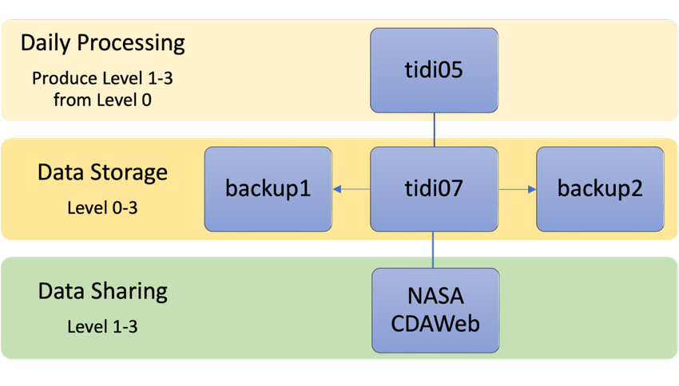

**Figure 17**. Illustration of TIDI data organization: data processing, data storage, and data sharing.